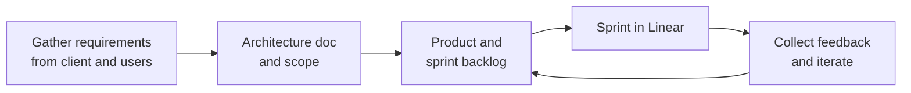

<h1 align="center">Hi, I'm Nitipoom Pansayor 👋</h1>
<h3 align="center">A com eng student who love to talk with human greater than code · Computer Engineering @ Chulalongkorn University</h3>

  
  
  

## About me

- 🎓 3rd-year Computer Engineering student at Chulalongkorn University (Intania 108 · CP51), graduating May 2028
- 🧭 Project Manager on 4 software projects, from client requirements to sprint delivery
- 🛠️ I don't only plan the work: I build the backend and AI pieces too
- 🏛️ President of **Core Team CP**, the Computer Engineering student committee (30 staff, 20 projects this year)
- 🔍 Open to Project Management, Product and Business Analyst internships

## What I'm working on

| Project | My role | What it is | Progress |
|---|---|---|---|
| **Portcas AI** capstone · private repo | PM · Backend & AI developer | AI pipeline that turns competition posters into structured data and personalized insights, with human review for low-confidence results. Hono · BullMQ · PostgreSQL + pgvector | 40 tasks by sprint 2 |
| **CBC Internal Platform** private repo | PM · Frontend developer · QA | Bilingual (EN/TH) internal platform with dashboards, member registration, a shared calendar, a document library and access requests. Next.js · React · TypeScript · Tailwind CSS | 43 users · 50 tasks by sprint 2 |
| **[Racha SE](https://github.com/Racha-SE)** course project | PM · Scrum Master · Backend developer | Software Engineering course project, run in Scrum sprints. Bun · Elysia · PostgreSQL | 120 tasks by sprint 3 |

## How I run a project

## Leadership

| Role | Highlight |
|---|---|
| **President, Core Team CP** Oct 2025 – now | Launched the committee's create–develop–handover structure · 30 staff · 12 of 20 projects delivered so far |
| **President, CP Olympics 2026** | Sports, games and faculty activities for 200 participants, finished under the THB 201,500 budget |
| **President, Hello CP53** | Welcomed 100 of 130 freshmen; 7 staff went on to join Core Team CP |
| **President, CP Link 2026** | Career guidance event: 12 sessions with seniors from different career fields |
| **Head of IT, Intania Games 2025** | Built [Intania888](https://github.com/NitipoomPansayor/Intania-Game-Website), a sports results and predictions site with 100+ users |
| **Head of Administration Branch, CUPB 18th** | Volunteer camp in Phetchaburi that helps local students prepare for Chulalongkorn University |

## Competitions

- 🏆 **Semi-finalist, Intania Case Competition 2026**: Top 16 of 180+ teams (InnovestX case), covering tech and finance
- 🤖 **6th of 50+ teams, AI Hackathon 2024 (Aihack Thailand)**: loan-eligibility ML model, ranked on the AUC leaderboard
- ⚡ **[Thinc 10-Day Project](https://github.com/NitipoomPansayor/10-Day-Project-thinc)**: my first role as Project Manager

## Tech stack

**Languages** 

**Frontend** 

**Backend and data** 

**AI and machine learning** 

**Tools and cloud** 

**Project management** 

**Also built with** 

---

Let's build something people actually use. Reach me on <a href="https://www.linkedin.com/in/nitipoom-pansayor/">LinkedIn</a> or by <a href="mailto:nitipoom.pansayor.forwork@gmail.com">email</a>.

